


 

 


 


<table>
<tr>
<td width="48%" valign="middle">
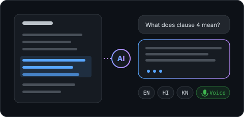
</td>
<td width="52%" valign="top">

### ⚖️ Legal Ease
**AI-based legal literacy platform**

Simplifies complex legal documents, generates legal templates and connects users with lawyers by specialization and location.

- RAG pipeline with **FastAPI**, **Sentence Transformers** and **FAISS**, answered through the **Gemini API** from uploaded PDFs
- OCR with **Tesseract.js** and **pdf.js**
- English · Hindi · Kannada translation and a voice-enabled interface
- Auto-generated NDAs, rental agreements and complaints
- "Find Lawyer" search backed by filtered **MySQL** queries

`FastAPI` `React` `Node.js` `MySQL` `RAG` `FAISS` `OCR`

[**Live Demo**](https://legalease-fawn.vercel.app/) &nbsp;·&nbsp; [**Source**](https://github.com/jhenkargr/Legal-Ease)

</td>
</tr>
<tr>
<td width="52%" valign="top">

### 📈 AdVantage
**AI-driven retail intelligence platform for SMEs**

Brings trend prediction, demand forecasting, inventory optimization and marketing automation into one platform.

- Trend engine combining **DistilBERT** and **VADER** sentiment with ensemble forecasting for 30-day predictions
- Inventory system using **HistGradientBoosting (Poisson)** and **TSB** models for demand and reorder points
- Generative AI (**NVIDIA**, **Groq LLaMA**) for product images and marketing content

`Python` `FastAPI` `React` `TypeScript` `PostgreSQL` `Scikit-learn` `LLM APIs`

[**Live Demo**](https://advantage-os-kappa.vercel.app/) &nbsp;·&nbsp; [**Source**](https://github.com/jhenkargr/Advantage-OS)

</td>
<td width="48%" valign="middle">
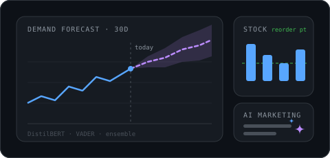
</td>
</tr>
</table>

 




 


<table width="100%">
<tr>
<td width="33%" valign="top" align="center"><b>Languages</b>  </td>
<td width="33%" valign="top" align="center"><b>Frontend</b>  </td>
<td width="33%" valign="top" align="center"><b>Backend</b>  </td>
</tr>
<tr>
<td valign="top" align="center"><b>Databases</b>  </td>
<td valign="top" align="center"><b>Tools &amp; Cloud</b>  </td>
<td valign="top" align="center"><b>Machine Learning</b>  </td>
</tr>
</table>

**Core CS** &nbsp; `DSA` &nbsp; `DBMS` &nbsp; `Operating Systems` &nbsp; `OOP` &nbsp; `Computer Networks`

 


